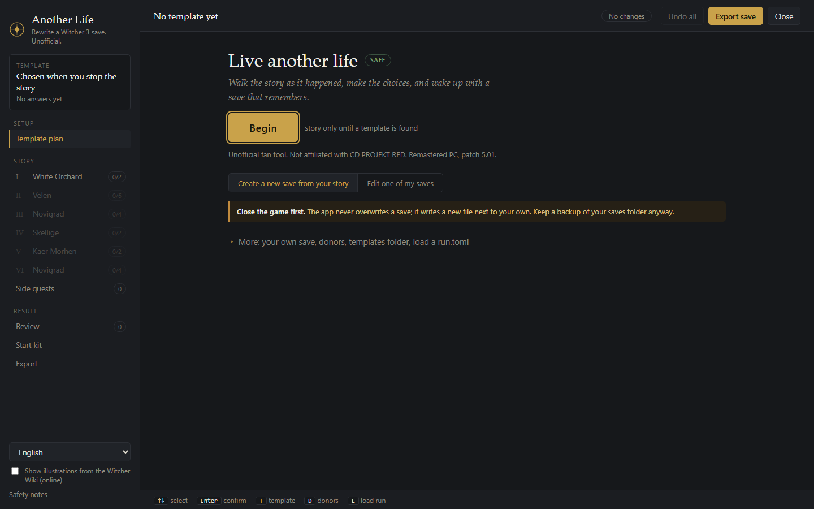
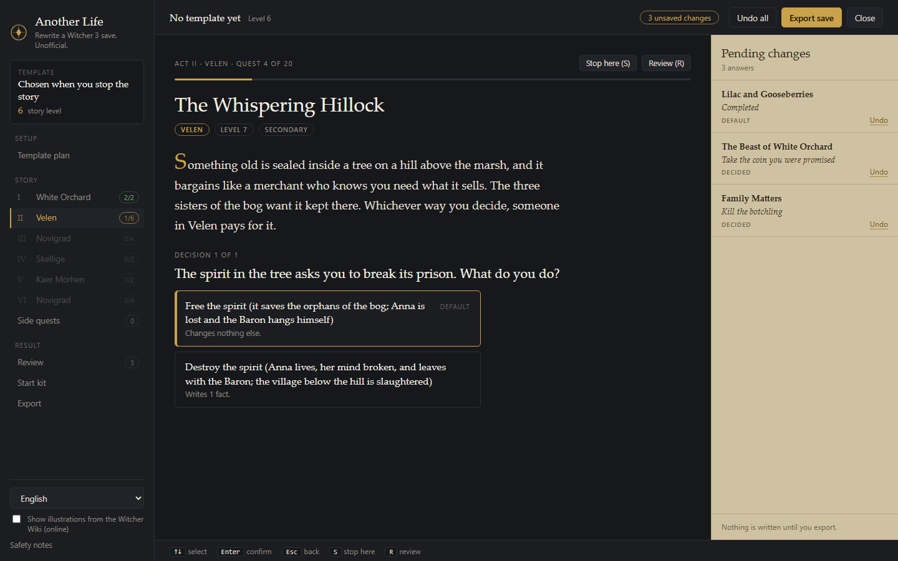
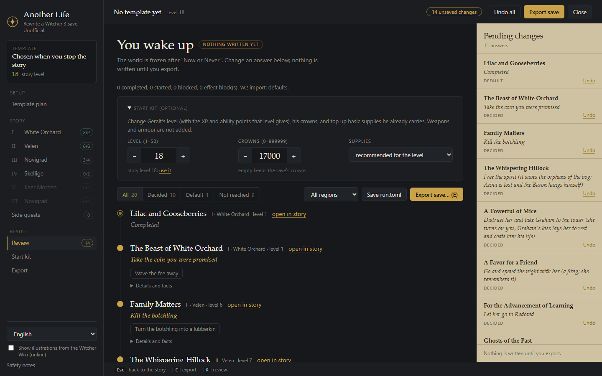
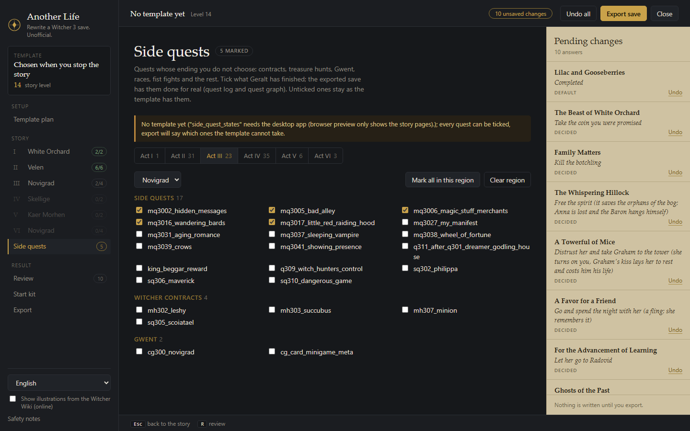
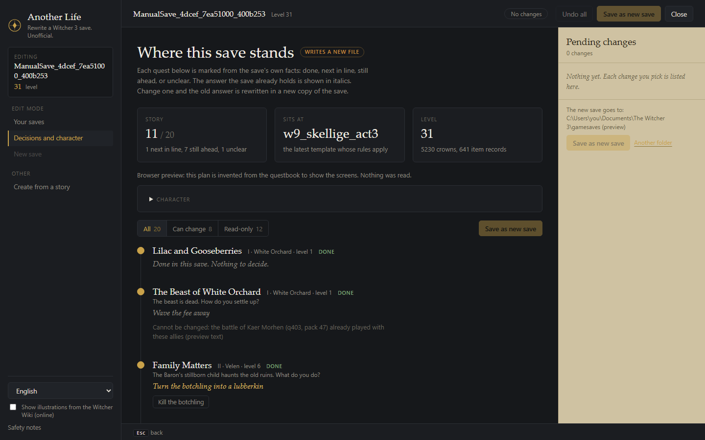
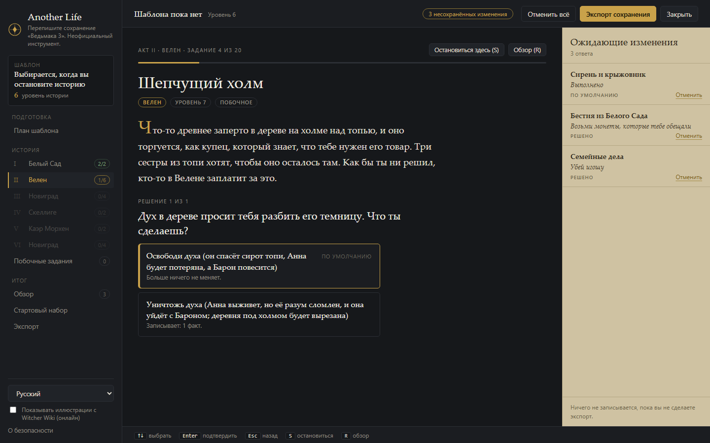

# Another Life for The Witcher 3

Walk The Witcher 3's story as an illustrated text RPG, make the real choices, then wake up in
Vizima with a save whose world state matches. Think Skyrim's *Alternate Start - Live Another
Life*, except you decide the past: who lived, who joined you, who you loved.

*Unofficial fan tool. Not affiliated with or endorsed by CD PROJEKT RED. The Witcher is a
trademark of CD PROJEKT S.A. No game files are included. See [NOTICE.md](NOTICE.md).*

## Why this exists

I lost my save. I did not want to replay the game from the start, and I did not need to: I
remember roughly what I had done. White Orchard, every Novigrad quest below level 16, and I had
just arrived in Skellige at level 18 with about 17,000 crowns and some armour.

What I wanted was a tool that turns "here is what I did" into a save that matches it. This is
that tool. It is early, and it only claims what has been tested in the game (see Status below).

## Screenshots

The screenshots come from the browser preview with invented data and the Witcher Wiki
illustrations switched off. They show the screens, not a real save.

| | |
| --- | --- |
|  |  |
| Welcome: create a save from your story, or edit one of your saves. | A quest page: what happened, then each decision with what it changes. |
|  |  |
| Review ("You wake up"): every answer in one list, plus the optional start kit (level, crowns, supplies). | Side quests: tick what Geralt has finished. |
|  |  |
| Edit my save: where the save stands and which decisions can be changed (invented plan in the preview). | The interface and the questbook texts also come in Russian. |

## Status

Early software, honestly:

- **Proven in game** (on the author's own patch 5.01 Remastered PC saves): an unedited repack
  loads and plays; a changed game fact is read by the game and survives the game's own re-save
  (for example the Gwent difficulty setting visibly changes); a quest graph transplant makes
  a quest count as done in play (several quests, two branches, a never-started quest).
- **Not proven**: position and world edits, DLC and mod state, other game patches, and most of
  the questbook. Quests in the sample content still carry `PLACEHOLDER_` effects and the
  exporter refuses those on purpose.
- Content: acts and quests are being researched and written act by act. Everything is traced
  to a script, a quest graph or a diff between two real saves; nothing is guessed.

Phase details live in [CLAUDE.md](CLAUDE.md), findings in [docs/research.md](docs/research.md).

## Features

- Illustrated, second-person retelling of the main story and side quests (original text).
- Each answer states plainly what it changes in the world; defaults if you do not care.
- Review screen before export.
- Export writes one **new** save (`ManualSave_*.sav`) next to your saves; it never overwrites.
- CLI (`w3al`) for inspecting, diffing and validating saves and the questbook.
- English and Russian UI.

Out of scope for v1: level and gold (the in-game console already does it on any save).

## Install

- **Player:** download the Windows installer (or the portable zip) from the repository's Releases page,
  run it, and read the [player guide](docs/PLAYER_GUIDE.md) ([Russian](docs/PLAYER_GUIDE_RU.md)).
  Needs The Witcher 3 Remastered (PC, patch 5.01) and the WebView2 runtime (ships with Windows 11).
  The builds are not code signed, so SmartScreen may warn: More info, Run anyway.
  Both include the `w3al` command line tool next to the app; see [docs/DISTRIBUTION.md](docs/DISTRIBUTION.md).
- **From source:** needs Rust stable (MSVC toolchain on Windows) and the Tauri CLI.

```bash
cargo test                                         # w3save, w3al-core, w3al-cli, w3graph
cargo run -p w3al-cli -- lint                      # validate the questbook
cargo install tauri-cli --version "^2" --locked
cargo tauri dev                                    # run the app
cargo tauri build                                  # Windows installer (NSIS)
```

**Template saves are not in git.** The exporter patches a real template save, and those are
personal files, so the installer picks them up from `templates/` at build time. To build a
working installer, put copies of your own saves in a folder, set `W3AL_FIXTURES` to it and run
`pwsh scripts/collect-templates.ps1` (see [templates/README.md](templates/README.md)).
A build without them runs, but cannot export.

**CLI.** The installer puts `w3al.exe` next to the app and the portable zip has it in its root; it finds
`questbook/` and `templates/` next to itself. From the install or unzipped folder:

```powershell
.\w3al.exe --help
.\w3al.exe export --run my.toml --out-dir .      # write a new save from a run file
.\w3al.exe edit-plan "C:\copies\my.sav"          # where a save of yours stands in the questbook
.\w3al.exe character "C:\copies\my.sav"          # read level, items and the like from a save
.\w3al.exe lint                                  # validate the questbook
```

Other subcommands: `dump`, `roundtrip`, `diff`, `facts`, `check-save`, `edit-fact`, `journal`,
`journal-diff`, `journal-set`, `tree`, `graph-diff`, `questbook-json` (from source:
`cargo run -p w3al-cli -- <subcommand>`).

## How it works

1. The app walks the questbook (TOML) and records your answers.
2. Answers resolve to effects: game facts, journal entries and quest graph state.
3. The export copies a template save that is close to your chosen starting point, patches the
   effects into it (`w3save` reads and writes the container, variable table and token tree,
   and rebases all offsets), and writes the result as a new `.sav` plus sidecars.

## Layout

`crates/w3save` (save format) - `crates/w3graph` (quest graphs of your own install) -
`crates/w3al-core` (questbook, runs, effects, export) - `crates/w3al-cli` -
`src-tauri` + `ui` (app) - `questbook` (TOML content, CC BY-SA).
Start with [CLAUDE.md](CLAUDE.md), [DECISIONS.md](DECISIONS.md) and [CONTRIBUTING.md](CONTRIBUTING.md).

## Safety

- Existing saves are never overwritten (files are created with `create_new`).
- Back up `Documents\The Witcher 3\gamesaves` before trying it, and close the game first.
- Never run experiments on files in the game's own saves folder; use copies.
- Real saves are never committed to this repository (`*.sav` is gitignored).

## Licence

- Code: [MIT](LICENSE-MIT) OR [Apache-2.0](LICENSE-APACHE), at your option.
- Questbook content (`questbook/`): [CC BY-SA 4.0](questbook/LICENSE).
- Third-party credits: [NOTICE.md](NOTICE.md).

## Disclaimer

This is an unofficial fan project, not affiliated with or endorsed by CD PROJEKT RED.
The Witcher is a trademark of CD PROJEKT S.A. Illustrations are linked from the Witcher Wiki
and remain the property of their owners. Use at your own risk and keep backups of your saves.
